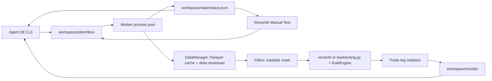

# Backtester

A backtesting harness an AI agent drives through a CLI, with a local GUI so you can
watch it work.

```bash
python -m venv .venv && .venv/Scripts/activate   # or source .venv/bin/activate
pip install -e ".[gui,dev]"
cp .env.example .env                             # add your Alpaca keys

bt worker                                        # terminal 1: the job runner
streamlit run gui/app.py                         # terminal 2: the GUI
bt submit examples/request.json                  # terminal 3: queue a backtest
```

## How it fits together



- **Smart cache.** Bars live in `workspace/cache/<feed>/<adjustment>/<timeframe>/<SYMBOL>.parquet`
  with a sidecar recording the covered window. A repeated request downloads only the
  missing range before or after what is already on disk, so holidays and weekends never
  look like gaps. The most recent 24 hours are always refreshed because fresh bars can
  still be filling in.
- **One strategy, two engines.** A strategy emits entry and exit signals once;
  `vectorbt` and `backtesting.py` both consume them. Metrics are computed from the
  equity curve in `backtester/pipeline/engines/base.py` rather than from each library's
  own statistics, so the two engines are directly comparable.
- **Rules are enforced twice.** `RuleEngine` masks signals before simulation, then
  `validate_trades` re-checks the realised trade log and writes `rule_violations` into
  the summary. Any non-zero value means an engine bug.
- **Filters never drop rows**, because that would corrupt indicator warm-up. They
  produce a boolean `tradable` column that blocks entries only.
- **Concurrency.** The worker claims jobs by renaming files, which is atomic, and runs
  them in a process pool. Multi-ticker requests fan out into one child job per ticker.
  Every job heartbeats, so a crashed worker's jobs are requeued once and then failed
  with `stale_worker`.

## Layout

| Path | What it holds |
| --- | --- |
| `backtester/data/` | timeframes, the Alpaca client, the Parquet cache, the delta-merging `DataManager` |
| `backtester/pipeline/` | request schema, session columns, filters, rules, the staged pipeline, engine adapters |
| `backtester/strategies/` | the strategy interface, registry and `sma_cross` |
| `backtester/jobs/` | the file queue, job state and the worker |
| `backtester/reporting/` | `summary.json`, `trades.*`, `equity.parquet` and `report.md` |
| `gui/` | the Streamlit GUI (git-ignored) |
| `workspace/` | cache, queue, state and results (git-ignored) |

## Commands

| Command | Purpose |
| --- | --- |
| `bt submit <file>` | validate and queue a request (`-` reads stdin) |
| `bt worker [--once]` | run the worker pool; `--once` drains the queue and exits |
| `bt status [--job-id ID]` | the whole queue, or one job |
| `bt results <id>` | a finished job's summary and file paths |
| `bt fetch AAPL,MSFT --start ... --end ...` | warm the cache without backtesting |
| `bt strategies` | registered strategies and their parameter schemas |

[AGENTS.md](AGENTS.md) is the contract the agent follows: exit codes, the request
schema, phases, error codes and stuck-job handling.

## Adding a strategy

Subclass `BaseStrategy`, declare a `StrategyParams` model, return `Signals`, and call
`register()`. See [backtester/strategies/sma_cross.py](backtester/strategies/sma_cross.py).
Both engines pick it up with no further work.

## Tests

```bash
pytest            # the whole suite runs offline, with no credentials
pytest -m "not slow"
```

Tests seed the Parquet cache directly, so even the end-to-end worker runs never touch
the network.
